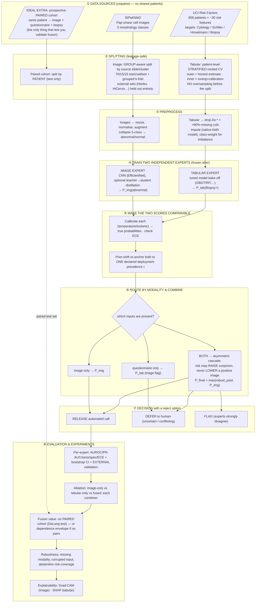
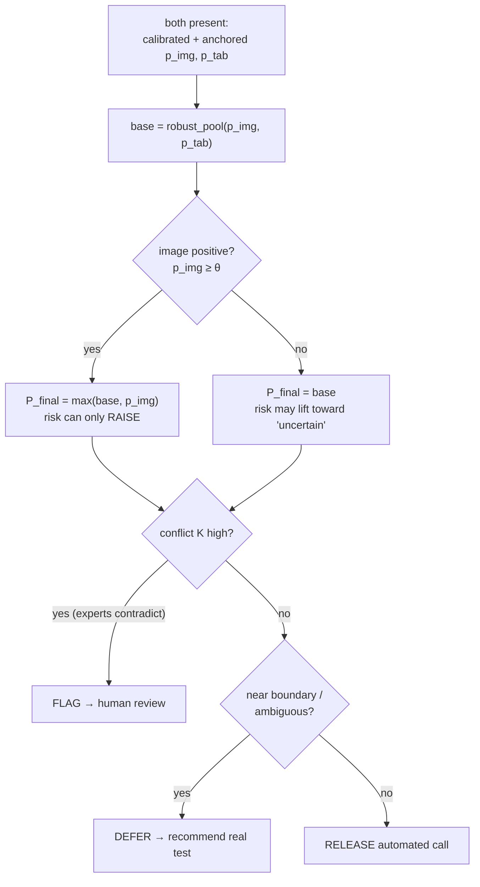

# The Ideal Any-Modality Cervical Screening Pipeline — a full walkthrough

> **Who this is for.** Someone who knows basic ML (train/test splits, a classifier, AUROC) but not this project. By the end you should understand *what data we have, what every label means, what each model predicts, how to split the data, what experiments to run, and how the pieces fit together* — described as the **ideal** design, i.e. what one *should* do here, independent of what any current code happens to do.

---

## 1. The problem in one paragraph

We want **one screening tool** that can take **either** a microscope image of cervical cells, **or** a patient's risk-factor questionnaire, **or both**, and output a trustworthy "how likely is this abnormal?" score. The catch: the best public image data and the best public questionnaire data are **two completely separate datasets** — different people, no patient is in both, and they even use different label systems. So we cannot train one big model on rows that contain both. The ideal solution trains **two separate expert models** and combines their *outputs* at decision time.

---

## 2. The two datasets and **every** label

### 2.1 Image dataset — **SIPaKMeD** (Pap-smear cytology)

Isolated single-cell images from Pap smears. Each image has **one of 5 morphology labels**:

| # | Label (class) | What the cell is | Screening meaning |
|---|---|---|---|
| 0 | **Dyskeratotic** | Keratinising cells with HPV-associated change | **Abnormal** |
| 1 | **Koilocytotic** | Koilocytes — the classic cytopathic hallmark of HPV | **Abnormal** |
| 2 | **Metaplastic** | Immature metaplastic cells (a normal reactive change) | Normal / benign |
| 3 | **Parabasal** | Immature squamous cells from deep layers | Normal |
| 4 | **Superficial-Intermediate** | Mature squamous surface cells | Normal |

**Binary collapse used everywhere downstream:** `abnormal = {Dyskeratotic, Koilocytotic}`, `normal = {Metaplastic, Parabasal, Superficial-Intermediate}`. So the image label boils down to **abnormal vs. normal cell**.

> ⚠️ Note the ceiling of what this label can mean: koilocytosis signals *productive HPV infection*, which is often transient and is **not** the same as high-grade pre-cancer. The image label = "does this cell look HPV-abnormal," not "does this person have cancer."

### 2.2 Tabular dataset — **UCI Cervical Cancer (Risk Factors)**

858 patients, one row each. Columns split into **features** (inputs) and **labels** (things to predict).

**Features (inputs — the risk questionnaire):**

| Group | Columns |
|---|---|
| Demographics | `Age` |
| Sexual / reproductive history | `Number of sexual partners`, `First sexual intercourse` (age), `Num of pregnancies` |
| Smoking | `Smokes` (yes/no), `Smokes (years)`, `Smokes (packs/year)` |
| Contraception | `Hormonal Contraceptives` (y/n), `… (years)`, `IUD` (y/n), `IUD (years)` |
| STD history | `STDs` (y/n), `STDs (number)`, + 11 specific flags (`condylomatosis`, `cervical/vaginal/vulvo-perineal condylomatosis`, `syphilis`, `pelvic inflammatory disease`, `genital herpes`, `molluscum contagiosum`, `AIDS`, `HIV`, `Hepatitis B`, `HPV`), `STDs: Number of diagnosis`, `STDs: Time since first/last diagnosis` |

**Target labels (the 4 diagnostic-test outcomes — each is `1`=positive/abnormal, `0`=negative):**

| Label | The test | Where it sits in the real screening pathway |
|---|---|---|
| **Citology** (Cytology) | **Pap smear** — cells read under a microscope | Primary screening |
| **Schiller** | **Lugol's iodine test** — abnormal tissue fails to stain brown | Visual screening |
| **Hinselmann** | **Colposcopy** — magnified visual exam of the cervix | Follow-up after an abnormal screen |
| **Biopsy** | **Histopathology** — tissue examined by a pathologist | **Confirmatory / gold standard** |

**History labels (a patient's *past* diagnoses — NOT prediction targets, and dangerous as features):**

| Label | Meaning |
|---|---|
| `Dx:HPV` | Previously diagnosed with HPV |
| `Dx:CIN` | Previously diagnosed with CIN (a graded pre-cancerous lesion) |
| `Dx:Cancer` | Previously diagnosed with cervical cancer |
| `Dx` | "Has any prior diagnosis" (roughly the union of the above) |

> ⚠️ **Two label traps to avoid** (they are why other work reports fake 99%):
> 1. **Don't predict `Dx:Cancer`** — it's a *record of a past diagnosis*, not a disease you can foresee, and it is almost perfectly determined by `Dx`/`Dx:HPV`/`Dx:CIN` (predicting it from them is circular).
> 2. **Don't feed the `Dx:*` columns or the other test outcomes in as features** when predicting a test — that leaks the answer.
>
> **Ideal target choice = `Biopsy`** (histology is the closest thing to ground truth). Optionally also model `any-of-4-positive` as a higher-sensitivity screen.

---

## 3. What each model predicts

| Model | Input | Output | Plain meaning |
|---|---|---|---|
| **Image expert** | one cervical cell image | `P_img(abnormal) ∈ [0,1]` | "How HPV-abnormal does this cell look?" — the actual *finding* |
| **Tabular expert** | one risk questionnaire | `P_tab(positive) ∈ [0,1]` | "How likely is a positive biopsy given this risk profile?" — a *pre-test risk* |

Both are pushed onto the **same yes/no axis**: `P(Y=1)` where `Y = "cervical abnormality / SIL-risk"`. That shared axis is the only thing that lets two models trained on different data talk to each other.

**Honest performance you should expect** (this drives the whole design):
- Image expert: strong on its own data, ~**0.73 AUROC** on *external* cytology sets (realistic).
- Tabular expert: **~0.65 AUROC** at best, leakage-free — a **weak triage signal**, not a diagnostician. No model or tuning breaks this ceiling because the risk factors barely correlate with the outcome.

---

## 4. The ideal pipeline — top-to-bottom diagram



### Reading the diagram in words
1. **Two separate datasets** come in (plus, ideally, a small **paired** cohort you collect yourself — the only way to ever prove fusion helps).
2. **Split carefully** so no information leaks (details in §6).
3. **Preprocess** each modality.
4. **Train two independent experts**; then **freeze** them.
5. **Calibrate** each so its number is a real probability, and **re-anchor** both to the same assumed real-world prevalence so they live on the same scale.
6. **Route**: run whichever expert's data you were given. If you have both, **combine asymmetrically** — the questionnaire can only *raise* concern, never overrule the image.
7. **Decide** with an "I'm not sure → ask a human" option.
8. **Evaluate** each expert honestly, ablate the fusion, and (ideally) prove its value on the paired cohort.

---

## 5. Fusion logic — how the two scores combine (stages ⑥–⑦ in detail)

Stages ⑥ (combine) and ⑦ (decide) are the heart of the system, so here they are in full. Two ideas: an **asymmetric cascade** for *how* to combine, and an **agreement/disagreement** check for *how confident to be*.

### 5.1 Why a *cascade*, and why *asymmetric*

The two experts are **not peers** — they sit at different stages of the real screening pathway:

- **Tabular = a pre-test risk.** From lifestyle/history it estimates *"before anyone looks, how likely is a problem?"* — an **upstream prior**.
- **Image = a finding.** It actually looks at the cells — a **downstream measurement of the thing itself**.

Clinically you combine these **asymmetrically**: pre-test risk sets your starting suspicion, then the actual test *updates* it (a Fagan / likelihood-ratio update). You would never *average* "she is statistically low-risk" with "her cells look abnormal" into a mushy middle — the cell finding is closer to the truth and must dominate. Treating them as equal votes is a **category error**.

**Two concrete reasons symmetric averaging is wrong here:**
1. **It drags the strong expert down.** The image expert (~0.73 external AUROC) is much stronger than the tabular one (~0.65). A plain average pulls the good score toward the weak one — measured result: fused AUROC ends up *below* image-only. You would be actively **hurting** the system.
2. **The signals can point opposite ways.** The image "abnormal" class is koilocyte-dominated (productive HPV), a *weak/negative* predictor of high-grade disease — so a truly abnormal image can co-occur with a "low-risk" questionnaire. A symmetric average would then **talk the abnormal image down**, losing sensitivity — the one thing a screen must never lose.

### 5.2 The mechanic — "raise but never lower"

After both scores are calibrated and re-anchored to the same prevalence:

```text
base = robust_pool(p_img, p_tab)          # a cautious combination (linear/sum pool)
if image is positive (p_img ≥ θ):
        P_final = max(base, p_img)        # image sets a FLOOR — risk cannot pull it down
else:
        P_final = base                    # a normal-looking image can be lifted toward "uncertain"
```

The single line `max(base, p_img)` **is** the safety principle: **a positive cell finding can only be reinforced, never reduced, by the questionnaire.** The questionnaire's only power is to *raise* suspicion when the image is unsure.

**Worked examples** (anchored probabilities, θ = 0.5):

| Case | p_img | p_tab | base (pool) | image positive? | **P_final** | What happened |
|---|---|---|---|---|---|---|
| Both abnormal | 0.85 | 0.70 | 0.78 | yes | `max(0.78, 0.85)=`**0.85** | reinforced |
| Both normal | 0.15 | 0.20 | 0.18 | no | **0.18** | confident negative |
| **Image+, risk−** | 0.85 | 0.10 | 0.48 | yes | `max(0.48, 0.85)=`**0.85** | **image wins — risk did NOT lower it** |
| **Image−, risk+** | 0.20 | 0.85 | 0.53 | no | **0.53** | **risk raised 0.20→0.53 ("uncertain"), but did NOT force a positive** |

The last two rows are the asymmetry made numeric: swapping which expert is high gives **different** answers. A high *image* stays high; a high *questionnaire* over a low image only lifts the score into the "go do the real test" zone. A symmetric average would give both cases the same ~0.5 and destroy this behaviour.

### 5.3 Agreement vs. disagreement — how confident to be

`P_final` is **not** thresholded blindly. The system also asks *"do my two sources agree?"* — because two roughly-independent signals **agreeing** is much stronger evidence, and **disagreeing** means at least one is wrong, which should make the machine cautious.

Define a **conflict score `K`**: high only when the two calibrated calls sit on **opposite sides of the boundary with confidence** (one clearly abnormal, the other clearly normal); `K ≈ 0` when they agree. Intuitively, **K = how hard the two experts contradict each other**.

| Image | Risk | Agreement? | Conflict `K` | Outcome |
|---|---|---|---|---|
| abnormal | abnormal | **agree** | low | **RELEASE** — confident positive |
| normal | normal | **agree** | low | **RELEASE** — confident negative |
| abnormal | normal | **disagree** | high | **FLAG** — positive call *(image floor holds)* but escalated to a human |
| normal | abnormal | **disagree** | high | **FLAG / DEFER** — risk raised suspicion on a normal image → send for the real test |

Plus an orthogonal rule: if **either** score sits **near the boundary** (neither confidently abnormal nor normal) → **DEFER**, regardless of agreement, because the call itself is ambiguous.

**The three outcomes:**
- **RELEASE** — experts agree *and* the call is confident → emit the automated answer.
- **DEFER** — near the boundary, or only a lone weak expert (questionnaire) is available → hand to a human / recommend the real test.
- **FLAG** — the two experts strongly disagree → the machine refuses to auto-decide and escalates (a confident image and a confident questionnaire pointing opposite ways is exactly when a silent answer is most dangerous).

### 5.4 The decision flow for the "both present" branch



### 5.5 The net safety property

Putting the cascade and the agreement check together gives one guarantee worth stating plainly:

> **Adding the questionnaire can trigger extra caution (DEFER/FLAG) or lift a borderline score — but it can never turn a confident "abnormal cell" into a released "normal."** The worst-case downside on sensitivity (the metric that matters in screening) is **zero**, and the upside is earlier caution on higher-risk patients.

---

## 6. How the datasets **should** be split (this is where most projects cheat)

### 6.1 Image (SIPaKMeD) — **group-aware** split
SIPaKMeD contains many cells cropped from the **same source slide / field-of-view**. If you split cells randomly, near-duplicate cells from one slide land in both train and test → the model "memorises" and your accuracy is fake.
- **Ideal:** split by **source group** (slide/cluster/patient) so all cells from one source stay on one side. Use **70/15/15 train/val/test** (or grouped k-fold CV), and select models on **val**, report once on the untouched **test**.
- Keep **entirely separate external datasets** (Herlev, HiCervix, APACC, CRIC) that are **never trained on** — evaluate on them to measure real-world generalisation.

### 6.2 Tabular (UCI) — **stratified, nested, no early oversampling**
Each patient is one row, so splitting is by patient automatically. The dangers are **imbalance** (~6% positive) and **oversampling leakage**.
- **Ideal:** **nested cross-validation** — an *outer* loop (e.g. repeated stratified 5-fold) gives an honest performance estimate; an *inner* loop does hyperparameter tuning **and** probability calibration. Stratify folds on the rare positive class.
- **Never oversample (SMOTE/ADASYN) before splitting.** If you must oversample, do it **inside the training fold only**. (Oversampling first, then splitting, is the single most common way people fake 99% on this dataset.)
- **Drop the leakage columns** (`Dx:*`) and never use other test outcomes as features.
- Because positives are so few (35–74), prefer **repeated nested CV over a single held-out test** — it uses the scarce positives more efficiently and still gives an unbiased estimate.

### 6.3 The paired cohort (the ideal addition) — split **by patient**
The one experiment that can actually validate *fusion* needs patients who have **both** a cytology image and a questionnaire **and** a gold-standard biopsy. Even ~50–100 such patients let you compare fused-vs-best-single with a proper statistical test. Split it **by patient**, use it **only as a test set** (never to train the experts).

---

## 7. The ideal experiments (what to actually run)

**A. Build & validate each expert on its own data**
1. Train the image expert; calibrate; report AUROC / PR-AUC / sensitivity / specificity / ECE **with bootstrap 95% CIs** on the held-out test **and** on the external datasets.
2. Run a **tuned model bake-off** for the tabular expert (several model families, hyperparameter search **inside** the CV); pick the best target (Biopsy) and model; calibrate; report the same metrics + CIs.

**B. The fusion ablation (the core scientific comparison)**
3. Compare, on the **same** evaluation subjects: **image-only vs. tabular-only vs. fused**, and within "fused" compare combiners (robust sum pool vs. naive-Bayes vs. the asymmetric cascade). This is what tells you whether — and how — combining helps.
   - *If you have the paired cohort:* report fused-vs-best-single AUROC with a **DeLong test** and CI.
   - *If you don't:* you **cannot** measure joint accuracy. Instead report a **dependence-sensitivity envelope** — the fused score's plausible range over the (unknown, unmeasurable) correlation between the two modalities — and state plainly that a real number needs the paired cohort.

**C. Trust & safety experiments**
4. **Calibration:** reliability diagrams + ECE per expert and fused.
5. **Abstention / selective prediction:** a **risk-coverage curve** — as you let the system defer more uncertain cases, does the accuracy on the ones it *keeps* go up? A conformal reject option gives a distribution-free guarantee.
6. **Robustness:** performance with a **missing** modality (should equal the single-expert path) and with **corrupted** inputs (noise, blur, missing answers).

**D. Explainability (needed for anything clinical)**
7. **Grad-CAM** on the image expert (is it looking at the nucleus, not the background?), **SHAP** on the tabular expert (which risk factors drove the score?).

---

## 8. What you may and may not claim (intellectual honesty)

- ✅ You **can** claim: each expert's own performance (with CIs, incl. external validation); that the system runs any modality and degrades gracefully; that it's calibrated and can abstain.
- ✅ You **can** claim fusion's value **only** if you have the paired cohort and a proper test (DeLong).
- ❌ You **cannot** claim joint patient-level accuracy from the two unpaired public datasets — no amount of modelling fixes the absence of paired labels.
- ❌ You must not report the "99%" style numbers that come from oversampling-before-split or from predicting `Dx:Cancer` off the `Dx` columns — those are leakage, not skill.

---

## 9. One-sentence summary

**Train two honest, separately-validated experts (a strong cytology-image detector and a weak risk-factor triage), calibrate both to a common probability scale, then at inference run whichever modality is present and — when both are present — let the questionnaire only *raise* suspicion behind the image's decision, with an "ask a human" option for uncertain or conflicting cases; validate each expert on its own data (plus external sets) and validate the *fusion itself* only on a small purpose-collected paired cohort.**
