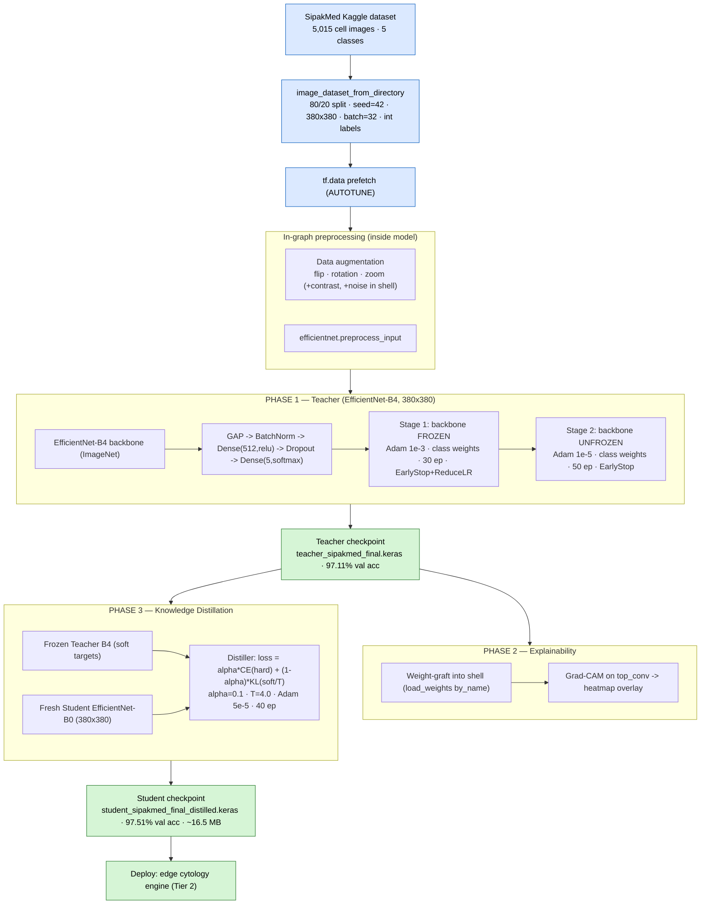
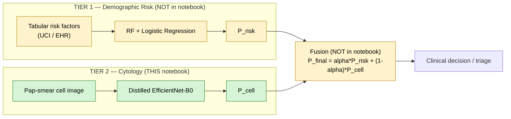
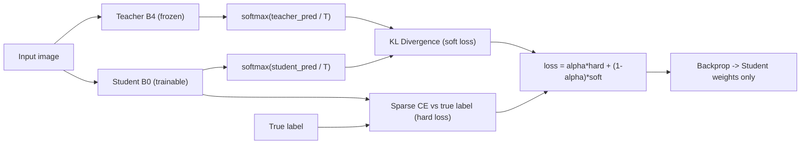

# Cervical Cancer Cytology Classification — End-to-End Pipeline Documentation

**Artifact documented:** `efficientnetb4-sipakmed.ipynb` (20 cells)
**Supporting sources:** `Cervical Cancer Paper Pipeline.docx` (upgrade/roadmap log) · `Cervical Cancer Research.xlsx` (literature review, 8 sheets)
**Compiled:** 2026-06-20
**Target venue framing (per roadmap):** Q1/Q2 journal — *"Comprehensive Two-Tier Intelligent Screening Framework for Cervical Cancer."*

> **TL;DR.** The notebook implements **Tier 2** of a planned two-tier system: a deep-learning **cytology image classifier** for the 5-class SipakMed Pap-smear dataset. A heavyweight **EfficientNet-B4 "Teacher"** is trained in two stages (frozen → fine-tuned) to **97.11%** validation accuracy, made interpretable with **Grad-CAM**, and then **knowledge-distilled** into a compact **EfficientNet-B0 "Student"** that reaches **97.51%** validation accuracy. **Tier 1** (a tabular Random-Forest + Logistic-Regression risk model) and the **fusion layer** are described in the roadmap but are **not implemented in this notebook**.

---

## Table of Contents

1. [The Big Picture: Two-Tier Framework](#1-the-big-picture-two-tier-framework)
2. [Datasets](#2-datasets)
3. [End-to-End Pipeline Diagram](#3-end-to-end-pipeline-diagram)
4. [Preprocessing & Data Pipeline](#4-preprocessing--data-pipeline)
5. [Phase 1 — Teacher Model (EfficientNet-B4)](#5-phase-1--teacher-model-efficientnet-b4)
6. [Phase 2 — Explainability (Grad-CAM)](#6-phase-2--explainability-grad-cam)
7. [Phase 3 — Knowledge Distillation (Student EfficientNet-B0)](#7-phase-3--knowledge-distillation-student-efficientnet-b0)
8. [Evaluation Methods — What Was Done vs. Not Done](#8-evaluation-methods--what-was-done-vs-not-done)
9. [Results Summary](#9-results-summary)
10. [Reproducibility & Environment](#10-reproducibility--environment)
11. [Engineering Notes, Discrepancies & Risks](#11-engineering-notes-discrepancies--risks)
12. [Literature Context](#12-literature-context)
13. [Gaps & Recommended Next Steps](#13-gaps--recommended-next-steps)
14. [Cell-by-Cell Map](#14-cell-by-cell-map)

---

## 1. The Big Picture: Two-Tier Framework

The DOCX roadmap positions the larger research program as a **"Two-Tier Intelligent Screening Funnel"** that unifies the team's prior tabular-risk work with this new image model:

| Tier | Name | Input | Model | Output | Status in **this** notebook |
|------|------|-------|-------|--------|------------------------------|
| **Tier 1** | Demographic Risk Engine | Tabular (lifestyle, clinical history, demographics) | Fused ML: **Random Forest + Logistic Regression** | Risk probability `P_risk` | ❌ Not present (prior/separate work) |
| **Tier 2** | Edge-Deployed Cytology Engine | Pap-smear cell image | **Distilled EfficientNet-B0** | Malignancy probability `P_cell` | ✅ **Implemented here** |
| **Fusion** | Fused Decision Matrix | Both | Weighted combination | `P_final = α·P_risk + (1−α)·P_cell` | ❌ Conceptual only (in DOCX) |

**Clinical intent (from roadmap):** Tier 1 cheaply flags high-risk patients from questionnaire/EHR data; Tier 2 gives a definitive cytological read on a microscope image; when both exist they are cross-referenced to minimize false negatives. The distilled Tier-2 model is small enough (claimed **16.5 MB**) to run locally on a tablet/phone attached to a low-cost digital microscope in rural clinics.

> ⚠️ **Scope note:** Everything below describes **Tier 2**, which is the entirety of `efficientnetb4-sipakmed.ipynb`. Tier 1 and the fusion equation are documented here only for context; no tabular data, RF/LR code, or fusion code exists in the notebook.

---

## 2. Datasets

### 2.1 SipakMed (primary — used in this notebook)

| Property | Value |
|----------|-------|
| Source | Kaggle: `prahladmehandiratta/cervical-cancer-largest-dataset-sipakmed` (original: cs.uoi.gr/~marina/sipakmed.html) |
| Modality | Pap-smear **cytology**, isolated single-cell crops |
| Classes | **5** morphological cell types |
| Loader path | `/kaggle/input/datasets/prahladmehandiratta/cervical-cancer-largest-dataset-sipakmed` |
| Folder names | `im_Dyskeratotic`, `im_Koilocytotic`, `im_Metaplastic`, `im_Parabasal`, `im_Superficial-Intermediate` |
| **Images actually loaded** | **5,015 files** → 4,012 train / 1,003 validation (from cell-18 runtime log) |
| Split | 80 / 20 stratified-by-folder, `seed=42` |

**The five classes (clinical meaning):**

| Idx | Class | Cytological category |
|-----|-------|----------------------|
| 0 | Dyskeratotic | Abnormal / koilocytotic-related (HPV change) |
| 1 | Koilocytotic | Abnormal (HPV hallmark) |
| 2 | Metaplastic | Benign / reactive |
| 3 | Parabasal | Normal (immature squamous) |
| 4 | Superficial-Intermediate | Normal (mature squamous) |

> ⚠️ **Count discrepancy worth resolving before publication.** The static class-weight table (cell 5) uses the **official SipakMed benchmark counts** of **4,049** single cells (813 / 825 / 793 / 787 / 831). But `image_dataset_from_directory` actually enumerated **5,015** files in the Kaggle folder. So the class weights are computed from a *different, smaller* count than the data actually trained on. The DOCX likewise quotes "5,015 images." The weights are therefore an approximation of the true on-disk distribution — fine for training, but the paper must state one canonical count.

### 2.2 Tier-1 numeric dataset (referenced, NOT used here)

The roadmap's Tier 1 refers to the **UCI Cervical Cancer (Risk Factors)** dataset (~858 patients; demographic/behavioral/medical-history features) consumed by a separate Random-Forest + Logistic-Regression model. It does not appear in this notebook.

---

## 3. End-to-End Pipeline Diagram

### 3.1 Implemented Tier-2 pipeline (this notebook)



### 3.2 Conceptual two-tier framework (roadmap context)



---

## 4. Preprocessing & Data Pipeline

| Step | Implementation | Detail |
|------|----------------|--------|
| **Ingestion** | `tf.keras.utils.image_dataset_from_directory` | Reads class-labelled folders directly |
| **Resize** | `image_size=(380, 380)` | EfficientNet-B4 native resolution; **the B0 student is also fed 380×380** (see note) |
| **Batching** | `batch_size=32` | Sized for 2× Tesla T4 GPUs |
| **Split** | `validation_split=0.2`, `subset="training"/"validation"`, `seed=42` | 80/20 |
| **Labels** | `label_mode='int'` | Integer labels (enables sparse CE + manual class weighting) |
| **Pipeline opt.** | `.prefetch(AUTOTUNE)` | Overlaps data loading with GPU compute |
| **Normalization** | `efficientnet.preprocess_input` | Applied **inside** the model graph, not in `tf.data` |
| **Augmentation** | Keras preprocessing layers **inside** the model | Teacher (cell 6): `RandomFlip(h&v)`, `RandomRotation(0.2)`, `RandomZoom(0.1)`. Reconstruction shell + student data flow (cells 13/18): adds `RandomContrast(0.15)` + `GaussianNoise(0.05)` and uses `0.15` rotation/zoom |
| **Class imbalance** | Static class weights (cell 5) | `weight_i = total / (num_classes × count_i)`, from benchmark counts |

**Class weights actually used (teacher training only):**

| Class | Benchmark count | Weight |
|-------|-----------------|--------|
| Dyskeratotic | 813 | 1.00 |
| Koilocytotic | 825 | 0.98 |
| Metaplastic | 793 | 1.02 |
| Parabasal | 787 | 1.03 |
| Superficial-Intermediate | 831 | 0.97 |

> The classes are nearly balanced, so the weights barely deviate from 1.0 — they have minimal practical effect. **Note:** class weights are applied in teacher training (cells 7 & 9) but **NOT** in distillation (cell 18 has no `class_weight` argument).

> ⚠️ **Student resolution note.** `STUDENT_IMG_SIZE = (224,224)` is defined in the config (cell 3) — B0's native resolution — but the distillation cell (18) builds the student with `input_shape=(380,380,3)` and feeds 380×380 images. The student therefore runs at **380×380**, not 224×224. This still trains fine and keeps teacher/student input aligned, but it inflates the student's FLOPs/latency versus its native size and should be stated explicitly (or changed) for the "edge-efficient" claim.

---

## 5. Phase 1 — Teacher Model (EfficientNet-B4)

### 5.1 Architecture (cell 6)

```
Input(380, 380, 3)
  → Augmentation (RandomFlip h&v, RandomRotation 0.2, RandomZoom 0.1)
  → efficientnet.preprocess_input
  → EfficientNet-B4 backbone  (ImageNet weights, include_top=False)
  → GlobalAveragePooling2D
  → BatchNormalization
  → Dense(512, relu)
  → Dropout(0.5)
  → Dense(5, softmax)          # "pred"
```

- **Backbone:** `EfficientNetB4`, ImageNet-pretrained, ~19M backbone parameters (literature value; the notebook's printed summary is not saved in this version).
- **Distribution:** `tf.distribute.MirroredStrategy()` across **2× Tesla T4** GPUs; the whole model is built inside `strategy.scope()`.

### 5.2 Two-stage transfer-learning schedule

| | **Stage 1 — Feature Extraction** (cell 7) | **Stage 2 — Fine-Tuning** (cell 9) |
|---|---|---|
| Backbone | **Frozen** (`trainable=False`) | **Unfrozen** (`trainable=True`) |
| Optimizer | Adam, **lr = 1e-3** | Adam, **lr = 1e-5** (avoids destroying pretrained weights) |
| Loss | SparseCategoricalCrossentropy | SparseCategoricalCrossentropy |
| Epochs (cap) | 30 | 50 |
| Class weights | ✅ | ✅ |
| Callbacks | EarlyStopping(val_loss, patience 8, restore best), ReduceLROnPlateau(×0.3, patience 4, min 1e-6), ModelCheckpoint | EarlyStopping(val_loss, patience 6, restore best), ModelCheckpoint |
| Output file | `teacher_sipakmed_stage1.keras` | `teacher_sipakmed_final.keras` |

**Result:** Teacher reaches **97.11% validation accuracy** (referenced throughout cells 12/14/18).

---

## 6. Phase 2 — Explainability (Grad-CAM)

Because the saved teacher could not be deserialized directly under the multi-GPU strategy (a known TF/Keras issue), the notebook uses a **weight-grafting** workaround (cells 13–15):

1. **Surgically extract** `model.weights.h5` from the `.keras` zip archive (the on-disk weight blob measured **213.29 MB**).
2. **Rebuild an identical "shell"** architecture (`build_teacher_shell`) with the *same layer names* (`efficientnetb4`, `global_average_pooling2d`, `batch_normalization`, `dense`, `dropout`, `pred`).
3. **`load_weights(..., by_name=True)`** to map weights onto the shell, bypassing graph deserialization.
4. **Grad-CAM** (`get_gradcam_heatmap`): builds a sub-model from the B4 backbone input to its final conv layer **`top_conv`**, takes gradients of the predicted-class score w.r.t. that feature map, GAP-pools the gradients, weights the feature maps, applies ReLU + normalization, then upsamples and overlays a JET colormap on the original image (`cv2.addWeighted`, 0.4/0.6).

**Purpose (per roadmap):** visually prove the model attends to the **cell nucleus and boundaries**, not background artefacts. The DOCX lists Grad-CAM as **"COMPLETED & SAVED."** Output of cell 15 confirms a 3-panel heatmap figure was generated.

---

## 7. Phase 3 — Knowledge Distillation (Student EfficientNet-B0)

### 7.1 Goal

Compress the 97.11% B4 teacher into a small B0 student suitable for edge deployment while retaining accuracy — the central novelty claim of the paper.

### 7.2 Student architecture (cell 18)

```
Input(380, 380, 3)
  → EfficientNet-B0 backbone  (ImageNet weights, include_top=False, trainable=True)
  → GlobalAveragePooling2D
  → BatchNormalization
  → Dense(512, relu)
  → Dropout(0.3)
  → Dense(5, softmax)
```

### 7.3 Distiller (custom `keras.Model` subclass)



| Hyperparameter | Value |
|----------------|-------|
| Temperature `T` | **4.0** |
| `alpha` (hard-label weight) | **0.1** → soft/distillation weight = 0.9 |
| Student loss (hard) | SparseCategoricalCrossentropy, `reduction=NONE` |
| Distillation loss (soft) | KLDivergence, `reduction=NONE` |
| Loss reduction | `tf.nn.compute_average_loss` (multi-GPU-safe global averaging) |
| Optimizer | Adam, **lr = 5e-5** |
| Epochs | 40 |
| Callbacks | EarlyStopping(**val_accuracy**, patience 8, restore best), ModelCheckpoint(best val_accuracy) |
| Distribution | MirroredStrategy, 2× T4 |

**Training trajectory (cell 18 log):** val_accuracy climbs 0.643 → 0.863 → 0.924 … best at **epoch 36 = 0.97507**, weights restored from epoch 36. Final student saved as `student_sipakmed_final_distilled.keras` (cell 19).

> ⚠️ **Two methodological caveats reviewers may raise (document/address before submission):**
> 1. **Double-softmax temperature.** The teacher's last layer is already `softmax`, so `teacher_predictions` are probabilities; the code then applies `softmax(probabilities / T)` again. Canonical Hinton distillation softens **logits**, not probabilities. The same double-softmax is applied to the student. This flattens both distributions heavily and makes the KL term very small (≈0.005 in the logs).
> 2. **Effective signal balance.** With `alpha=0.1`, the loss is `0.1·CE + 0.9·KL`, but because the KL term is tiny in magnitude, the **hard-label cross-entropy numerically dominates** the gradient. In practice the student is learning largely from true labels + ImageNet transfer, with only a weak distillation contribution. The strong 97.51% result is real, but attributing it primarily to *distillation* should be argued carefully (an ablation — student trained with no teacher — would settle it). Also note the standard `T²` scaling on the soft loss is omitted.

---

## 8. Evaluation Methods — What Was Done vs. Not Done

**Short answer: Yes, evaluation was performed — but it is partial and uneven between the two models, and there is no held-out test set.**

### ✅ Done

| Evaluation | Model | Where | Notes |
|------------|-------|-------|-------|
| Overall accuracy | Teacher | cell 10 | `np.mean(y_true==y_pred)`; **97.11%** reported |
| **Classification report** (precision/recall/F1 per class) | Teacher | cell 10 | `sklearn.classification_report` — code present; printed output **not saved** in this notebook version (run in an earlier session) |
| **Confusion matrix** | Teacher | cell 10 | `sklearn.confusion_matrix` + seaborn heatmap |
| **Grad-CAM** interpretability | Teacher | cells 13–15 | 3-panel heatmap overlay generated |
| Validation accuracy curve | Student | cell 18 | Per-epoch `val_accuracy`; best **97.51%** (epoch 36) |
| Best-model selection | Both | callbacks | EarlyStopping `restore_best_weights` + ModelCheckpoint |

### ❌ Not done (gaps for a Q1 submission)

- **No student confusion matrix, classification report, or per-class precision/recall/F1.** The student is evaluated *only* by scalar `val_accuracy` during training. The DOCX explicitly flags the student's "Final Accuracy Matrix" as **"Needs Regeneration."**
- **No held-out test set.** Only an 80/20 train/**validation** split exists; the validation set doubles as the evaluation set, and model selection (EarlyStopping/checkpointing) is done *on it* — so the reported numbers are validation, not unbiased test, performance.
- **No ROC / AUC, PR curves, MCC, Cohen's κ, or specificity/sensitivity** — important for a clinical/screening framing.
- **No external / cross-dataset validation** (e.g., Herlev, LBC). This is the single most common limitation cited across the literature review (see §12) and applies here too.
- **No measured efficiency metrics in code.** Model sizes (**79.4 MB → 16.5 MB**) and the "tablet-deployable" claim come from the DOCX, not from any measurement cell. The only measured artefact is the teacher's extracted `model.weights.h5` = 213.29 MB. Parameter counts, FLOPs, and inference latency are not benchmarked.
- **No teacher-vs-student head-to-head table, no statistical significance, no k-fold / repeated-seed runs.**
- **No calibration analysis** (relevant given the double-softmax note in §7).
- **Tier 1 and fusion are unevaluated** because unimplemented.

> The DOCX "Action Plan" anticipates this: it describes a planned **"Asset Harvest"** script that would load both saved models, evaluate them, and dump publication-grade figures — but that script is **not in the notebook**.

---

## 9. Results Summary

| Model | Role | Resolution | Val. accuracy | Reported size | Selection epoch |
|-------|------|-----------|---------------|---------------|-----------------|
| EfficientNet-B4 | Teacher | 380×380 | **97.11%** | ~79.4 MB *(DOCX)* / 213 MB weights blob | best `val_loss` |
| EfficientNet-B0 | Student (distilled) | 380×380 | **97.51%** | **~16.5 MB** *(DOCX)* | 36 (best `val_accuracy`) |

**Headline narrative (per roadmap):** the student is **~4.8× smaller** yet **slightly more accurate** than the teacher on the validation set — the core selling point for edge deployment. (All accuracies are **validation**, not test; size figures are roadmap claims pending in-code measurement.)

---

## 10. Reproducibility & Environment

| Aspect | Setting |
|--------|---------|
| Platform | Kaggle Notebooks, 2× NVIDIA Tesla T4 (Compute Capability 7.5) |
| Frameworks | TensorFlow + **`tf_keras`** (legacy Keras 2 API; `TF_USE_LEGACY_KERAS=1`), JAX/jaxlib synced |
| Determinism | `SEED=42` set for `PYTHONHASHSEED`, `random`, `numpy`, `tf.random` |
| Distribution | `tf.distribute.MirroredStrategy` (data-parallel, NCCL all-reduce) |
| Key dependencies (cell 0) | `pip install -U jax jaxlib tf_keras tensorflow[and-cuda]` (requires a session restart) |
| Saved artifacts | `teacher_sipakmed_stage1.keras`, `teacher_sipakmed_final.keras`, `student_sipakmed_distilled.keras`, `student_sipakmed_final_distilled.keras` |

> **Determinism caveat:** seeds are set, but `tf.data` shuffling, multi-GPU all-reduce nondeterminism, and cuDNN autotuning mean exact bit-reproducibility is not guaranteed across runs.

---

## 11. Engineering Notes, Discrepancies & Risks

These are implementation realities visible in the code that a careful reviewer (or co-author) should know:

1. **Session breaks & recovery.** The notebook was run across multiple Kaggle sessions ("Resuming…", cell 11). Cell 12 is a **recovery script** that walks `/kaggle/input` to re-locate `teacher_sipakmed_final.keras`. Several cells reference a `teacher_sipakmed_fixed.keras` whose creation is **not shown** in the notebook.
2. **Weight-grafting workaround.** Direct `load_model` of the teacher under multi-GPU failed, so the pipeline extracts raw weights from the `.keras` zip and re-loads them `by_name` into a rebuilt shell (cells 13/14/18). Robust, but it means the *exact* trained graph is reconstructed by hand and depends on layer-name stability.
3. **Teacher train vs. shell mismatch.** The reconstruction shell (cells 13/18) is **not identical** to the trained teacher (cell 6): augmentation differs (`0.15` vs `0.2`/`0.1`, plus added contrast/noise) and `Dropout` is `0.3` vs `0.5`. This is **harmless for inference** (augmentation runs with `training=False`; dropout is inactive at inference; only weighted layers — backbone, BatchNorm, Dense, pred — are grafted, and those match), but the comments claiming a "precise duplicate of Step 6" are inaccurate.
4. **Student input size** is 380×380, not the configured/native 224×224 (see §4).
5. **Class weights not used in distillation** (§4).
6. **Distillation temperature applied to probabilities, not logits; `T²` omitted; KL term ≈0.005** (§7 caveats).
7. **Grad-CAM cell external symbols.** Cell 15 uses `cv2` and `class_names` without importing/defining them in that cell; these must have existed from an earlier session. A clean top-to-bottom run would need `import cv2` and the correct `class_names` variable.
8. **Saving a subclassed model warns** ("non-serializable objects … Defaulting to empty config"); the workaround is to save `base_student` directly (cell 19) rather than the `Distiller` wrapper.

---

## 12. Literature Context

The `Cervical Cancer Research.xlsx` (sheets: *Paper Link, New pipeline, Datasets, Selected Papers, Challenges in ML/DL, Next step, All papers details, KD & FL*) curates the prior art that motivates this design.

**Most relevant benchmarks on SipakMed (5-class):**

| Paper | Approach | Reported accuracy | Note |
|-------|----------|-------------------|------|
| Mehedi et al. 2024, *Sci. Reports* — **CCanNet** | Lightweight CNN (squeeze+residual+skip) + XAI | **98.53%** | Same dataset; the closest "lightweight + explainable" competitor |
| Chauhan et al. 2025, *Sci. Reports* | ResNet-152 + VGG-16 + PCA + SVM/RF voting | 98.47% (5-class) | Heavyweight hybrid |
| Zhao et al. 2022, *Multimedia Tools & Applications* | CCG-taming transformers + T2T-ViT | 99.88% (SipakMed) | Generative balancing + ViT |

**Recurring research gaps the literature flags (and which this notebook largely shares):**
- Validation on a **single small dataset** (SipakMed) with **no cross-dataset** test → uncertain generalization.
- **Interpretability** often shallow (Grad-CAM only).
- **Class imbalance / overlapping cells / image quality** under-addressed.
- **Computational heaviness** of hybrid/transformer models → motivates **knowledge distillation** (this work's angle).
- **No multimodal fusion** of risk factors + images → motivates the **two-tier** framing.

**Why KD here (from the "KD & FL" sheet):** medical deployment needs small, fast models; KD lets a big teacher's "dark knowledge" (soft labels + temperature) train a compact student. The sheet's reference example is *DCSNet* (lightweight KD model for lung histopathology). The roadmap also flags **Federated Learning** as a privacy-preserving future direction (not implemented).

---

## 13. Gaps & Recommended Next Steps

Prioritized for the stated **Q1/Q2 submission** goal:

1. **Build a proper test set.** Move to a **group-aware 80/10/10 train/validation/test** split (+ grouped k-fold CV) so reported numbers aren't selected on the same data used for early stopping — see [plans/DATA_PLAN.md §2](plans/DATA_PLAN.md).
2. **Full student evaluation.** Generate the student's confusion matrix, per-class precision/recall/F1, ROC-AUC, MCC, and a teacher-vs-student comparison table (the DOCX "Asset Harvest" script).
3. **Distillation ablation.** Train an identical B0 *without* the teacher (hard labels only) to isolate the true contribution of distillation; fix the logits/temperature/`T²` issue and re-tune `alpha`.
4. **Measure efficiency in code.** Report params, model size on disk, FLOPs, and CPU/edge latency to substantiate the 16.5 MB / "tablet-deployable" claims; align student input to 224×224 if edge cost matters.
5. **External validation.** Test on Herlev / LBC / CRIC to address the field's #1 limitation.
6. **Reconcile the dataset count** (4,049 vs 5,015) and state one canonical number.
7. **Optionally implement Tier 1 + fusion** to deliver the full two-tier story the roadmap promises.

---

## 14. Cell-by-Cell Map

| Cell | Type | Step | Purpose |
|------|------|------|---------|
| 0 | code | Step 1 | Install/sync DL libs (jax, tf_keras, tensorflow[and-cuda]); requires restart |
| 1 | code | — | Enable legacy Keras; verify GPU |
| 2 | code | Step 2 | Set `DATA_ROOT`; verify 5 class folders; make checkpoint dir |
| 3 | code | Step 3 | Global config: seeds, `IMG_SIZE`, `BATCH_SIZE`, class names |
| 4 | code | Step 4 | Load SipakMed train/val via `image_dataset_from_directory`; prefetch; sample viz |
| 5 | code | Step 5 | Static benchmark **class weights** |
| 6 | code | Step 6 | Build **Teacher B4** (augmentation + head) under MirroredStrategy |
| 7 | code | Step 7 | **Stage 1** training (frozen backbone, lr 1e-3) |
| 8 | code | — | Confirm stage-1 checkpoint saved |
| 9 | code | Step 8 | **Stage 2** fine-tuning (unfrozen, lr 1e-5) → final teacher |
| 10 | code | Step 9 | **Teacher evaluation**: classification report + confusion matrix + accuracy |
| 11 | md | — | "Resuming…" (session break) |
| 12 | code | — | Recovery script: locate & restore `teacher_sipakmed_final.keras` |
| 13 | code | Step 9.2 | Extract weights; define **teacher shell** for grafting |
| 14 | code | Step 9.2 | Graft weights `by_name` onto shell (single-GPU) |
| 15 | code | Step 9.2 | **Grad-CAM** heatmaps on `top_conv` |
| 16 | md | Step 10 | "Phase 3: Knowledge Distillation" header |
| 17 | md | — | KD intent note |
| 18 | code | Step 10 | Reload data; graft teacher; build **Student B0**; **Distiller** train (T=4, α=0.1) → 97.51% |
| 19 | code | — | Save final student model |

---

*Document generated from direct inspection of the notebook source + outputs, the DOCX roadmap, and the XLSX literature review. Items marked ⚠️ are factual discrepancies or methodological points to resolve before publication; they are reported faithfully rather than smoothed over.*
